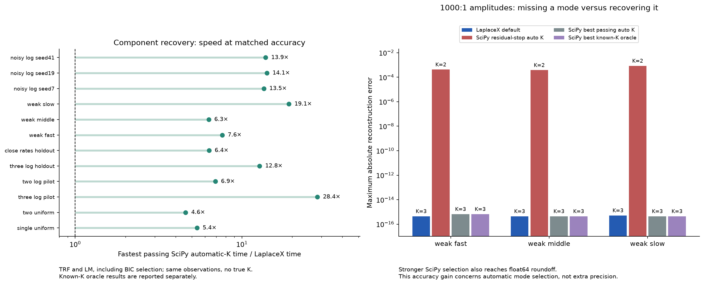
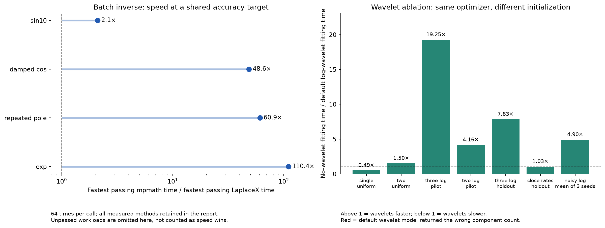

# Log-plane wavelet recovery and Python comparisons

Measured on 21 October 2026 after the noisy-component fixes. Times are medians
of five runs after one warmup, with shuffled method order and one BLAS thread.



## Component recovery

| Signal | LaplaceX default, ms | Fastest passing SciPy auto-K, ms | Speed ratio | Modes: LaplaceX / truth |
|---|---:|---:|---:|---:|
| single_uniform | 0.37 | 2.01 | 5.38× | 1 / 1 |
| two_uniform | 2.51 | 11.51 | 4.60× | 2 / 2 |
| three_log_pilot | 1.28 | 36.44 | 28.37× | 3 / 3 |
| two_log_pilot | 0.95 | 6.55 | 6.93× | 2 / 2 |
| three_log_holdout | 1.25 | 15.98 | 12.77× | 3 / 3 |
| close_rates_holdout | 7.99 | 50.77 | 6.35× | 2 / 2 |
| weak_fast | 2.41 | 18.31 | 7.61× | 3 / 3 |
| weak_middle | 2.11 | 13.33 | 6.32× | 3 / 3 |
| weak_slow | 2.09 | 40.00 | 19.13× | 3 / 3 |
| noisy_log_seed7 | 2.79 | 37.69 | 13.52× | 3 / 3 |
| noisy_log_seed19 | 2.58 | 36.42 | 14.13× | 3 / 3 |
| noisy_log_seed41 | 2.48 | 34.46 | 13.88× | 3 / 3 |

A passing automatic-count fit must recover the true count. Clean cases also
require normalized max reconstruction error ≤1e-8 and rate error ≤1e-5.
Noisy cases require clean-signal RMSE ≤noise σ and rate error ≤10%.
The comparator is the fastest passing automatic-K SciPy configuration among
the original residual-stop TRF fitter and TRF/LM BIC fitters. All outputs,
including failures and incorrect counts, remain in the full tables below.

## What changed

- Analyze `f(exp(x))`, rather than `exp(x)*f(exp(x))`. The negative log
  derivative of one exponential has the profile `A*exp(z-exp(z))`,
  `z=x+log(rate)`: rate changes translate the profile without changing
  its height. The old time factor favored slow components.
- Track persistent Mexican-Hat zero crossings from fine to coarse scales,
  retaining branches when coarse scales merge them. Initialize all persistent
  components in one fit instead of repeatedly fitting incomplete models.
- Fit rates and signed amplitudes jointly with an analytic Jacobian, damped
  Levenberg–Marquardt steps and scaled Householder QR. Final fitting uses
  the original observations, so log-grid interpolation is initialization only.
- Propagate sample noise through interpolation and wavelet filter weights,
  including covariance from reused observations. Condition residual proposals
  on both the existing amplitudes and rates.
- Use BIC by default, refit candidate deletions, and screen nearly dependent
  modes using conditional amplitude uncertainty. AICc remains configurable.
- Respect the component budget in both stages. Handle constants, noise-only
  signals, and large/small amplitude scales without spurious decay modes or
  overflowing the Python residual-energy calculation.

- Share an exact single-exponential shortcut between both routes. It accepts
  a model only after fitting every sample at the common numerical floor.
  Its single-mode speed benefit is not attributed to wavelet analysis.

## Fixing the remaining noisy count errors

A fast component outside the observed characteristic-time window had an
unconstrained extrapolated amplitude despite passing BIC. For uncertain modes
with `rate*t_min > 1`, the existing conditional amplitude test now requires
a refitted deletion. In-window overlapping modes retain the BIC/AICc decision.

The missed fourth component was suppressed by the initial interpolation-residual
noise estimate. Once fit residuals are within twice the expected noise energy,
automatic-noise searches cap their proposal noise scale by the residual MAD.
Explicit user-supplied noise is respected; the original estimate is never increased.
The covariance propagation, QR solver and pair-case optimizations remain in place.

| Previously failing case | Modes before → after / truth | Clean RMSE before → after | Largest rate error after |
|---|---:|---:|---:|
| log grid, case 41 | 3 → 2 / 2 | 1.78e-04 → 9.72e-05 | 0.17% |
| uniform grid, case 47 | 3 → 4 / 4 | 2.71e-04 → 9.28e-05 | 2.93% |

## Optimizing the previously slower pair cases

- Evaluate and cache exact propagated noise variance only at candidate crossings.
- Pad convolution boundaries once per residual rather than clamp each filter tap.
- For unresolved pairs, search both sides of the strongest residual ridge using
  conditional Jacobian projections. Keep the original proposals and existing selection rules.
- Reduce the Jacobian with Householder QR once per nonlinear iteration, then
  try damping changes on the small triangular problem. No normal equations or
  relaxed tolerances are introduced. The QR improvement is shared by both routes.

| Previously slower case | Before: wavelet / grid ms | Now: wavelet / grid ms | Wavelet speedup vs previous | Now: grid / wavelet |
|---|---:|---:|---:|---:|
| two_uniform | 4.03 / 3.63 | 2.51 / 3.77 | 1.61× | 1.50× |
| close_rates_holdout | 12.87 / 8.68 | 7.99 / 8.23 | 1.61× | 1.03× |

A separate **21-run** randomized check of the final binary confirms the local pair timings.
Cells show median [25th, 75th percentile] milliseconds; every fit must pass the component-count and accuracy checks.

| Case | Default wavelets, ms | Rate grid, ms | Grid / wavelet |
|---|---:|---:|---:|
| two_uniform | 3.16 [2.95, 3.40] | 4.36 [4.10, 4.88] | 1.38× |
| close_rates_holdout | 7.14 [6.84, 7.50] | 8.33 [7.90, 8.75] | 1.17× |

Before/after timings come from separate local runs; same-run grid/wavelet ratios
are the cleaner ablation. All models and final fits still use the original observations.

## Accuracy of automatic model selection

| Weak mode | LaplaceX modes / max abs error | SciPy residual-stop modes / max abs error | SciPy BIC / known-K accuracy |
|---|---:|---:|---|
| weak_fast | 3 / 4.44e-16 | 2 / 4.25e-04 | Also recovers 3 modes; error down to 6.66e-16 |
| weak_middle | 3 / 4.44e-16 | 2 / 3.79e-04 | Also recovers 3 modes; error down to 4.44e-16 |
| weak_slow | 3 / 5.20e-16 | 2 / 8.53e-04 | Also recovers 3 modes; error down to 4.44e-16 |

The 1000:1 amplitude cases expose the old SciPy automatic baseline's
`1e-6` residual-energy stopping rule: it can accept two modes before a weak
third mode is recovered. LaplaceX finds all three. This is an advantage over
that automatic stopping policy, not universal numerical accuracy superiority:
the stronger SciPy BIC and known-K variants also recover the modes accurately.
Float64 roundoff differences between successful fits are not meaningful accuracy wins.

## Validation across three seeds

The separately seeded validation recovered the correct count in **160/160** mixtures
with the rate-grid fallback disabled. It includes 80 clean and 80 noisy signals,
1–4 modes, linear and logarithmic sampling, and independently varied amplitudes/rates.
Maximum clean rate error: `1.828e-12` relative.
For noise σ=0.001, median / 95th-percentile / maximum rate errors were
**0.26% / 4.55% / 7.30%**.
Correct counts do not imply exact rates in noisy, poorly conditioned mixtures.
These are finite synthetic validation results, not a guarantee for all signals.

[Full validation protocol and individual outcomes](comparison/validation.json).
Model-selection development used seed 20261023; the separate validation
uses seed 20261029. Later sparse-variance and exact-single-mode performance
optimizations were revalidated on the same protocol; no selection parameters
were tuned to the second seed.
Validation timings are single observations and are not used for speed claims.

The two noisy failures in seed 20261107 are fixed: **158/160 → 160/160** correct counts.
There are **2 changed count decisions** on that regression set.
An additional seed (20261119) recovers **160/160** counts.
Across the three seeds: **480/480**, with fallback disabled.
The formerly failing set's noisy rate-error 95th percentile is **4.92% before / 4.85% after**.
The additional seed's noisy rate-error 95th percentile is **6.58%**.
Across all noisy mixtures, the largest rate error is **21.07%**;
this pre-existing limitation shows why correct counts do not guarantee precise individual rates.
Seed 20261107 is now regression data because its failures informed these fixes;
seed 20261119 was chosen before implementation and was not used to tune the rules.

The before-fix results and
[previous critical.cpp](comparison-before-noisy-fix/critical.cpp) are archived
alongside the previously benchmarked extension hash; these are actual previous fits.

## Wavelet ablation

`LaplaceX no wavelets` bypasses CWT and searches a 64-point log-rate grid.
It shares the new QR/LM solver, noise estimation, conditional candidate test,
BIC and deletion refits. This isolates initialization and candidate generation
from the optimizer rewrite. It removes the entire log-CWT stage; it does not
separately compare linear-time and log-time wavelets.

The default public route also includes Python fallback/noise checks. The
native no-wavelet entry omits that routing overhead; the explicitly
wavelet-only rows omit fallback checks and provide an additional comparison.

With the same optimizer, default wavelet initialization is **19.25×** faster
on the widely separated three-mode case and **7.83×** faster on its holdout.
The two-uniform and close-rate ratios are **1.50×** and
**1.03×** respectively; above 1 means wavelets are faster.
These ratios compare the native rate-grid route
with the public wavelet route, including its Python routing overhead.



The default configuration now uses 16 scales over [0.05,0.5] and 256 log points.
The older fine preset remains in the matrix. Both automatic fallback behavior
and the explicitly wavelet-only route are tested. Excess residual consistent
with estimated noise no longer triggers a redundant rate-grid fit.

## Before and after on identical fixtures

These compare the previous default library with the rewritten default library;
they include the combined effects of wavelet recovery, fitting and selection.
The ablation above is the narrower test of wavelet contribution.

| Case | Previous default ms / modes | New default ms / modes | Max abs error before → after |
|---|---:|---:|---:|
| single_uniform | 25.32 / 1 | 0.37 / 1 | 7.26e-14 → 3.33e-16 |
| two_uniform | 294.21 / 2 | 2.51 / 2 | 3.36e-12 → 6.66e-16 |
| three_log_pilot | 628.57 / 3 | 1.28 / 3 | 2.54e-12 → 9.99e-16 |
| two_log_pilot | 113.84 / 2 | 0.95 / 2 | 1.19e-13 → 2.22e-16 |
| three_log_holdout | 646.35 / 3 | 1.25 / 3 | 5.26e-12 → 4.44e-16 |
| close_rates_holdout | 1004.65 / 2 | 7.99 / 2 | 8.62e-05 → 4.44e-16 |
| noisy_log_seed7 | 574.99 / 3 | 2.79 / 3 | 3.74e-04 → 3.74e-04 |
| noisy_log_seed19 | 581.83 / 3 | 2.58 / 3 | 1.58e-04 → 1.58e-04 |
| noisy_log_seed41 | 582.79 / 3 | 2.48 / 3 | 1.77e-04 → 1.77e-04 |

Historical raw files and benchmark scripts are preserved in
[comparison-before-wavelet](comparison-before-wavelet/decomposition.json).

## Forward and inverse comparisons

| Inverse workload (64 times) | LaplaceX, ms / max error | Fastest passing mpmath, ms / max error | Speed ratio |
|---|---:|---:|---:|
| exp | 1.30 / 1.61e-14 (LaplaceX N64) | 143.98 / 0.00e+00 (mpmath Cohen dps30 auto) | 110.4× |
| repeated_pole | 1.47 / 3.16e-15 (LaplaceX N64) | 89.81 / 3.76e-10 (mpmath Cohen degree32) | 60.9× |
| damped_cos | 4.79 / 3.32e-12 (LaplaceX N64) | 232.76 / 0.00e+00 (mpmath Cohen dps30 auto) | 48.6× |
| sin10 | 83.58 / 1.50e-14 (LaplaceX N512) | 175.81 / 1.11e-16 (mpmath Cohen dps30 auto) | 2.1× |
| diffusion | No tested setting passed | 119.23 / 1.29e-10 (mpmath Cohen degree32) | — |
| delayed_step | No tested setting passed | 15570.83 / 1.07e-13 (mpmath deHoog degree64) | — |

Inverse ratios select the fastest passing tested setting in each package.
Every point must satisfy `abs(error) <= 1e-10+1e-8*abs(reference)`.
The Weeks inverse and forward quadrature do not use wavelet decomposition.
No wavelet-related accuracy gain is attributed to those paths. The inverse
still has limitations on singular/discontinuous signals. SciPy's rational
impulse response has richer inputs and is retained as a separate comparison.

## Fairness, settings, and limits

- Python `3.14.7 (tags/v3.14.7:823f032, Aug  5 2026, 10:51:32) [MSC v.1944 64 bit (AMD64)]`; `Windows-10-10.0.19045-SP0`.
- NumPy `2.5.3`, SciPy `1.18.1`, mpmath `1.3.0`
  with its `python` backend (gmpy2 not installed).
- LaplaceX: Release Windows x64 wheel, Zig 0.16.0 / Clang 21.1.0, C++17, -O3.
  Extension and script SHA-256 hashes, all run times and warnings are in JSON.
- Sections run serially. Setup, optimization and output conversion are timed;
  imports and reference generation are not. Medians are local observations,
  not cross-machine performance guarantees or confidence intervals.
- SciPy fitters use positive amplitudes, analytic Jacobians, two deterministic
  starts, tight tolerances, and at most five components. TRF uses bounded
  log rates/amplitudes; LM uses their unconstrained logarithmic parameterization.
  Known-K variants receive only the true count, never true rates/amplitudes.
- BIC variants evaluate K=1..5, stopping early only when reaching the common
  `1e-28*signal_energy` floor makes larger models incapable of improving BIC.
  The original residual-stop fitter is retained for comparability, not treated
  as the only SciPy alternative. Known-K oracle outcomes are reported below.
- Inverse references are analytic formulas evaluated at 60 digits then rounded
  to float64. Zero displayed error means agreement after rounding. mpmath's
  internal precision can exceed float64, so speed is not equal-precision proof.
- Forward callable tolerances match at 1e-10 absolute and 1e-8 relative.
  LaplaceX truncates at 1e6; omitted tails are negligible here. SciPy also gets
  an explicitly labeled squared-time endpoint variant for diffusion.
- These benchmarks use decaying real exponential mixtures, not arbitrary
  oscillatory signals or relaxation distributions. Decomposition no longer
  fabricates oscillation frequencies from Mexican-Hat side lobes. Manual
  oscillatory component reconstruction remains available.
- White homoscedastic noise is assumed. Colored noise, drift, unobserved
  time scales, and nearly coincident rates can invalidate count/rate inference.
  Fit reconstruction accuracy alone is not proof of uniquely identified modes.
- Configuration compatibility: `model_selection='bic'` is the new default;
  choose `'aicc'` for AICc. The old `use_aic` flag is retained as the enable
  switch for information-criterion pruning. `disable_als` now skips joint LM
  refinement despite its historical name. Defaults for scales/grid also changed.

## All forward measurements

| Case | Method | Median ms [min, max] | Max abs error | Target passed |
|---|---|---:|---:|---|
| exp_four | LaplaceX | 0.547 [0.505, 0.744] | 7.08e-16 | Yes |
| exp_four | SciPy quad | 0.886 [0.825, 1.334] | 1.39e-16 | Yes |
| exp_four | SciPy quad_vec | 4.898 [4.376, 6.589] | 5.55e-17 | Yes |
| exp_batch | LaplaceX | 8.360 [7.349, 8.414] | 2.05e-15 | Yes |
| exp_batch | SciPy quad | 4.958 [4.229, 5.846] | 2.65e-13 | Yes |
| exp_batch | SciPy quad_vec | 5.224 [4.917, 7.030] | 1.11e-16 | Yes |
| diffusion_four | LaplaceX | 0.842 [0.831, 1.285] | 6.90e-15 | Yes |
| diffusion_four | SciPy quad | 2.057 [1.991, 2.588] | 1.72e-12 | Yes |
| diffusion_four | SciPy quad_vec | Failed: ZeroDivisionError: division by zero | — | No |
| diffusion_four | SciPy quad_vec t=u^2 | 7.028 [6.799, 9.549] | 1.00e-15 | Yes |
| sampled_exp_2000 | LaplaceX spline | 8.045 [7.042, 9.506] | 2.41e-08 | No |
| sampled_exp_2000 | SciPy simpson | 1.824 [1.289, 1.889] | 6.64e-07 | No |
| sampled_exp_2000 | NumPy trapezoid | 0.812 [0.681, 1.309] | 1.90e-04 | No |
| sampled_exp_10000 | LaplaceX spline | 40.559 [37.386, 42.781] | 1.92e-10 | Yes |
| sampled_exp_10000 | SciPy simpson | 4.931 [4.640, 5.793] | 1.06e-09 | No |
| sampled_exp_10000 | NumPy trapezoid | 4.203 [3.587, 4.569] | 7.61e-06 | No |

## All inverse measurements

| Case | Method | Median ms [min, max] | Max abs error | Target passed |
|---|---|---:|---:|---|
| exp | LaplaceX N64 | 1.305 [1.239, 1.442] | 1.61e-14 | Yes |
| exp | LaplaceX N256 | 5.344 [5.009, 7.851] | 1.17e-14 | Yes |
| exp | mpmath Cohen degree32 | 80.180 [73.074, 93.071] | 2.74e-10 | No |
| exp | mpmath Cohen degree64 | 178.891 [162.112, 195.887] | 1.73e-18 | Yes |
| exp | mpmath Talbot degree32 | 276.311 [258.919, 283.047] | 8.67e-19 | Yes |
| exp | mpmath deHoog degree32 | 3047.133 [3011.340, 4318.015] | 0.00e+00 | Yes |
| exp | mpmath Stehfest degree32 | 321.810 [287.397, 490.480] | 6.04e-10 | No |
| exp | mpmath Cohen dps30 auto | 143.978 [143.450, 174.829] | 0.00e+00 | Yes |
| exp | SciPy impulse (rational coefficients) | 0.522 [0.459, 0.962] | 2.22e-16 | Yes |
| exp | LaplaceX N512 | 9.486 [8.966, 10.386] | 4.96e-14 | Yes |
| repeated_pole | LaplaceX N64 | 1.474 [1.431, 2.206] | 3.16e-15 | Yes |
| repeated_pole | LaplaceX N256 | 4.466 [4.224, 4.708] | 8.10e-15 | Yes |
| repeated_pole | mpmath Cohen degree32 | 89.807 [85.601, 108.996] | 3.76e-10 | Yes |
| repeated_pole | mpmath Cohen degree64 | 190.058 [188.903, 201.244] | 0.00e+00 | Yes |
| repeated_pole | mpmath Talbot degree32 | 270.520 [260.208, 290.640] | 0.00e+00 | Yes |
| repeated_pole | mpmath deHoog degree32 | 3002.674 [2987.012, 3342.204] | 0.00e+00 | Yes |
| repeated_pole | mpmath Stehfest degree32 | 307.240 [287.453, 331.747] | 3.78e-10 | Yes |
| repeated_pole | mpmath Cohen dps30 auto | 171.128 [167.247, 173.129] | 0.00e+00 | Yes |
| repeated_pole | SciPy impulse (rational coefficients) | 0.527 [0.502, 0.754] | 1.11e-16 | Yes |
| repeated_pole | LaplaceX N512 | 5.354 [5.224, 5.957] | 2.13e-14 | Yes |
| damped_cos | LaplaceX N64 | 4.787 [4.093, 8.973] | 3.32e-12 | Yes |
| damped_cos | LaplaceX N256 | 11.063 [10.987, 11.992] | 3.73e-14 | Yes |
| damped_cos | mpmath Cohen degree32 | 124.900 [113.213, 149.454] | 1.36e-06 | No |
| damped_cos | mpmath Cohen degree64 | 263.970 [259.549, 309.201] | 4.39e-15 | Yes |
| damped_cos | mpmath Talbot degree32 | 306.179 [290.050, 311.894] | 3.90e-09 | No |
| damped_cos | mpmath deHoog degree32 | 3397.470 [3169.293, 3707.342] | 0.00e+00 | Yes |
| damped_cos | mpmath Stehfest degree32 | 349.623 [326.218, 412.259] | 2.52e-02 | No |
| damped_cos | mpmath Cohen dps30 auto | 232.757 [231.785, 266.959] | 0.00e+00 | Yes |
| damped_cos | SciPy impulse (rational coefficients) | 0.510 [0.505, 0.629] | 4.47e-16 | Yes |
| damped_cos | LaplaceX N512 | 28.963 [27.564, 34.157] | 3.44e-14 | Yes |
| sin10 | LaplaceX N64 | 3.407 [2.860, 3.842] | 6.16e-02 | No |
| sin10 | LaplaceX N256 | 24.007 [23.003, 24.613] | 3.54e-09 | No |
| sin10 | mpmath Cohen degree32 | 89.813 [87.122, 94.820] | 5.86e+01 | No |
| sin10 | mpmath Cohen degree64 | 196.308 [194.229, 207.691] | 9.78e-06 | No |
| sin10 | mpmath Talbot degree32 | 263.778 [262.007, 280.996] | 1.51e+00 | No |
| sin10 | mpmath deHoog degree32 | 2996.438 [2948.347, 3022.031] | 1.45e-02 | No |
| sin10 | mpmath Stehfest degree32 | 301.517 [287.286, 324.241] | 1.03e+00 | No |
| sin10 | mpmath Cohen dps30 auto | 175.814 [171.129, 177.530] | 1.11e-16 | Yes |
| sin10 | SciPy impulse (rational coefficients) | 0.527 [0.516, 1.527] | 1.09e-14 | Yes |
| sin10 | LaplaceX N512 | 83.580 [76.501, 88.841] | 1.50e-14 | Yes |
| diffusion | LaplaceX N64 | 2.746 [2.700, 2.970] | 6.41e-01 | No |
| diffusion | LaplaceX N256 | 22.136 [21.798, 23.202] | 3.61e-01 | No |
| diffusion | mpmath Cohen degree32 | 119.226 [118.431, 122.177] | 1.29e-10 | Yes |
| diffusion | mpmath Cohen degree64 | 270.773 [264.543, 282.229] | 0.00e+00 | Yes |
| diffusion | mpmath Talbot degree32 | 290.565 [284.496, 332.775] | 0.00e+00 | Yes |
| diffusion | mpmath deHoog degree32 | 3122.274 [2993.308, 3423.661] | 0.00e+00 | Yes |
| diffusion | mpmath Stehfest degree32 | 310.319 [302.570, 400.727] | 6.66e-16 | Yes |
| diffusion | mpmath Cohen dps30 auto | 239.644 [231.296, 256.756] | 0.00e+00 | Yes |
| diffusion | LaplaceX N512 | 76.303 [73.756, 76.628] | 2.70e-01 | No |
| delayed_step | LaplaceX N64 | 3.830 [3.554, 4.020] | 1.35e-01 | No |
| delayed_step | LaplaceX N256 | 25.868 [25.298, 26.901] | 7.64e-02 | No |
| delayed_step | mpmath Cohen degree32 | 138.731 [134.331, 145.453] | 6.59e+02 | No |
| delayed_step | mpmath Cohen degree64 | 366.891 [351.592, 439.737] | 2.05e+07 | No |
| delayed_step | mpmath Talbot degree32 | Failed: ValueError: Output shape mismatch or nonfinite output | — | No |
| delayed_step | mpmath deHoog degree32 | 3094.255 [3078.294, 3262.028] | 6.89e-08 | No |
| delayed_step | mpmath Stehfest degree32 | 328.065 [303.611, 397.289] | 3.24e-01 | No |
| delayed_step | mpmath Cohen dps30 auto | 281.302 [270.418, 287.250] | 3.85e+00 | No |
| delayed_step | LaplaceX N512 | 99.823 [80.182, 120.450] | 3.07e-02 | No |
| delayed_step | mpmath deHoog degree64 | 15570.828 [14884.753, 18607.174] | 1.07e-13 | Yes |

## All component measurements

RMSE is against the clean generating signal. Rate error is the largest
relative error after sorting rates; it is omitted when counts disagree.

| Case | Method | Median ms [min, max] | Max abs error | Clean RMSE | Modes | Rate error |
|---|---|---:|---:|---:|---:|---:|
| single_uniform | LaplaceX default | 0.373 [0.362, 0.426] | 3.33e-16 | 3.23e-17 | 1 | 0.00e+00 |
| single_uniform | LaplaceX fine wavelets | 0.386 [0.353, 0.402] | 3.33e-16 | 3.23e-17 | 1 | 0.00e+00 |
| single_uniform | LaplaceX fine wavelets only | 0.200 [0.185, 0.266] | 3.33e-16 | 3.23e-17 | 1 | 0.00e+00 |
| single_uniform | LaplaceX no wavelets | 0.183 [0.172, 0.197] | 3.33e-16 | 3.23e-17 | 1 | 0.00e+00 |
| single_uniform | SciPy least_squares auto K | 5.080 [4.551, 5.753] | 2.22e-16 | 2.51e-17 | 1 | 0.00e+00 |
| single_uniform | SciPy least_squares known K | 4.691 [4.456, 5.271] | 2.22e-16 | 2.51e-17 | 1 | 0.00e+00 |
| single_uniform | SciPy TRF auto K BIC | 4.997 [4.456, 5.343] | 2.22e-16 | 2.51e-17 | 1 | 0.00e+00 |
| single_uniform | SciPy LM auto K BIC | 2.011 [1.985, 2.368] | 2.22e-16 | 2.51e-17 | 1 | 0.00e+00 |
| single_uniform | SciPy LM known K | 2.012 [1.899, 2.067] | 2.22e-16 | 2.51e-17 | 1 | 0.00e+00 |
| two_uniform | LaplaceX default | 2.505 [2.413, 3.081] | 6.66e-16 | 1.37e-16 | 2 | 4.44e-16 |
| two_uniform | LaplaceX fine wavelets | 3.222 [3.083, 3.899] | 6.66e-16 | 1.37e-16 | 2 | 4.44e-16 |
| two_uniform | LaplaceX fine wavelets only | 3.016 [2.960, 3.404] | 6.66e-16 | 1.37e-16 | 2 | 4.44e-16 |
| two_uniform | LaplaceX no wavelets | 3.769 [3.610, 3.843] | 4.44e-16 | 4.05e-17 | 2 | 2.22e-16 |
| two_uniform | SciPy least_squares auto K | 11.984 [11.280, 12.208] | 4.44e-16 | 6.47e-17 | 2 | 1.11e-16 |
| two_uniform | SciPy least_squares known K | 6.129 [5.870, 10.130] | 4.44e-16 | 6.47e-17 | 2 | 1.11e-16 |
| two_uniform | SciPy TRF auto K BIC | 12.422 [11.012, 14.105] | 4.44e-16 | 6.47e-17 | 2 | 1.11e-16 |
| two_uniform | SciPy LM auto K BIC | 11.515 [11.275, 12.219] | 4.44e-16 | 6.72e-17 | 2 | 5.55e-16 |
| two_uniform | SciPy LM known K | 9.987 [9.184, 10.898] | 4.44e-16 | 6.72e-17 | 2 | 5.55e-16 |
| three_log_pilot | LaplaceX default | 1.284 [1.211, 1.551] | 9.99e-16 | 4.41e-16 | 3 | 2.66e-15 |
| three_log_pilot | LaplaceX fine wavelets | 1.752 [1.575, 1.911] | 9.99e-16 | 4.41e-16 | 3 | 2.66e-15 |
| three_log_pilot | LaplaceX fine wavelets only | 1.344 [1.156, 1.474] | 9.99e-16 | 4.41e-16 | 3 | 2.66e-15 |
| three_log_pilot | LaplaceX no wavelets | 24.721 [24.474, 27.204] | 4.44e-16 | 7.92e-17 | 3 | 1.11e-16 |
| three_log_pilot | SciPy least_squares auto K | 91.387 [89.328, 122.085] | 1.33e-15 | 3.08e-16 | 3 | 1.33e-15 |
| three_log_pilot | SciPy least_squares known K | 7.913 [5.654, 13.317] | 1.33e-15 | 3.08e-16 | 3 | 1.33e-15 |
| three_log_pilot | SciPy TRF auto K BIC | 96.780 [86.549, 109.497] | 1.33e-15 | 3.08e-16 | 3 | 1.33e-15 |
| three_log_pilot | SciPy LM auto K BIC | 36.436 [33.185, 41.314] | 6.66e-16 | 2.18e-16 | 3 | 4.44e-16 |
| three_log_pilot | SciPy LM known K | 6.235 [4.841, 6.679] | 6.66e-16 | 2.18e-16 | 3 | 4.44e-16 |
| two_log_pilot | LaplaceX default | 0.945 [0.878, 1.023] | 2.22e-16 | 2.77e-17 | 2 | 0.00e+00 |
| two_log_pilot | LaplaceX fine wavelets | 1.146 [1.051, 1.944] | 2.22e-16 | 2.77e-17 | 2 | 0.00e+00 |
| two_log_pilot | LaplaceX fine wavelets only | 0.959 [0.883, 1.152] | 2.22e-16 | 2.77e-17 | 2 | 0.00e+00 |
| two_log_pilot | LaplaceX no wavelets | 3.930 [3.601, 4.218] | 4.44e-16 | 8.47e-17 | 2 | 2.22e-16 |
| two_log_pilot | SciPy least_squares auto K | 12.066 [11.010, 13.319] | 4.44e-16 | 1.22e-16 | 2 | 5.55e-16 |
| two_log_pilot | SciPy least_squares known K | 4.688 [4.487, 5.320] | 4.44e-16 | 1.22e-16 | 2 | 5.55e-16 |
| two_log_pilot | SciPy TRF auto K BIC | 11.847 [11.674, 18.570] | 4.44e-16 | 1.22e-16 | 2 | 5.55e-16 |
| two_log_pilot | SciPy LM auto K BIC | 6.554 [6.372, 7.704] | 4.44e-16 | 1.24e-16 | 2 | 4.44e-16 |
| two_log_pilot | SciPy LM known K | 5.235 [4.347, 6.431] | 4.44e-16 | 1.24e-16 | 2 | 4.44e-16 |
| three_log_holdout | LaplaceX default | 1.252 [1.206, 1.645] | 4.44e-16 | 1.30e-16 | 3 | 6.66e-16 |
| three_log_holdout | LaplaceX fine wavelets | 1.711 [1.479, 1.796] | 4.44e-16 | 1.30e-16 | 3 | 6.66e-16 |
| three_log_holdout | LaplaceX fine wavelets only | 1.258 [1.243, 1.348] | 4.44e-16 | 1.30e-16 | 3 | 6.66e-16 |
| three_log_holdout | LaplaceX no wavelets | 9.801 [9.148, 12.551] | 1.11e-15 | 3.20e-16 | 3 | 5.55e-15 |
| three_log_holdout | SciPy least_squares auto K | 34.015 [33.623, 35.449] | 8.88e-16 | 1.72e-16 | 3 | 1.22e-15 |
| three_log_holdout | SciPy least_squares known K | 6.578 [6.464, 7.126] | 8.88e-16 | 1.72e-16 | 3 | 1.22e-15 |
| three_log_holdout | SciPy TRF auto K BIC | 34.223 [33.401, 35.196] | 8.88e-16 | 1.72e-16 | 3 | 1.22e-15 |
| three_log_holdout | SciPy LM auto K BIC | 15.983 [15.754, 19.419] | 4.44e-16 | 1.64e-16 | 3 | 2.22e-16 |
| three_log_holdout | SciPy LM known K | 4.477 [4.344, 4.822] | 4.44e-16 | 1.64e-16 | 3 | 2.22e-16 |
| close_rates_holdout | LaplaceX default | 7.991 [6.503, 8.888] | 4.44e-16 | 6.23e-17 | 2 | 1.11e-15 |
| close_rates_holdout | LaplaceX fine wavelets | 7.521 [6.975, 9.729] | 4.44e-16 | 6.23e-17 | 2 | 1.11e-15 |
| close_rates_holdout | LaplaceX fine wavelets only | 7.224 [6.947, 10.018] | 4.44e-16 | 6.23e-17 | 2 | 1.11e-15 |
| close_rates_holdout | LaplaceX no wavelets | 8.225 [7.471, 10.128] | 4.44e-16 | 6.99e-17 | 2 | 2.44e-15 |
| close_rates_holdout | SciPy least_squares auto K | 54.927 [51.490, 105.991] | 4.44e-16 | 6.45e-17 | 2 | 5.77e-15 |
| close_rates_holdout | SciPy least_squares known K | 60.167 [48.441, 109.361] | 4.44e-16 | 6.45e-17 | 2 | 5.77e-15 |
| close_rates_holdout | SciPy TRF auto K BIC | 56.857 [52.435, 185.788] | 4.44e-16 | 6.45e-17 | 2 | 5.77e-15 |
| close_rates_holdout | SciPy LM auto K BIC | 50.772 [49.698, 60.417] | 4.44e-16 | 5.81e-17 | 2 | 3.77e-15 |
| close_rates_holdout | SciPy LM known K | 52.233 [45.729, 75.031] | 4.44e-16 | 5.81e-17 | 2 | 3.77e-15 |
| weak_fast | LaplaceX default | 2.405 [2.350, 3.748] | 4.44e-16 | 1.52e-16 | 3 | 8.35e-13 |
| weak_fast | LaplaceX fine wavelets | 2.870 [2.669, 4.386] | 4.44e-16 | 1.52e-16 | 3 | 8.35e-13 |
| weak_fast | LaplaceX fine wavelets only | 3.163 [2.604, 4.089] | 4.44e-16 | 1.52e-16 | 3 | 8.35e-13 |
| weak_fast | LaplaceX no wavelets | 10.592 [10.123, 13.745] | 4.44e-16 | 1.82e-16 | 3 | 1.09e-14 |
| weak_fast | SciPy least_squares auto K | 29.859 [26.271, 45.012] | 4.25e-04 | 2.00e-04 | 2 | Count mismatch |
| weak_fast | SciPy least_squares known K | 15.779 [13.228, 21.235] | 4.44e-16 | 1.42e-16 | 3 | 6.62e-14 |
| weak_fast | SciPy TRF auto K BIC | 47.061 [38.924, 63.915] | 4.44e-16 | 1.42e-16 | 3 | 6.62e-14 |
| weak_fast | SciPy LM auto K BIC | 18.310 [16.651, 22.645] | 6.66e-16 | 1.42e-16 | 3 | 9.81e-14 |
| weak_fast | SciPy LM known K | 6.413 [5.748, 11.020] | 6.66e-16 | 1.42e-16 | 3 | 9.81e-14 |
| weak_middle | LaplaceX default | 2.109 [2.019, 2.782] | 4.44e-16 | 8.54e-17 | 3 | 3.46e-14 |
| weak_middle | LaplaceX fine wavelets | 2.562 [2.406, 2.994] | 4.44e-16 | 8.54e-17 | 3 | 3.46e-14 |
| weak_middle | LaplaceX fine wavelets only | 2.307 [2.187, 2.385] | 4.44e-16 | 8.54e-17 | 3 | 3.46e-14 |
| weak_middle | LaplaceX no wavelets | 8.851 [8.672, 9.124] | 4.44e-16 | 9.25e-17 | 3 | 8.79e-14 |
| weak_middle | SciPy least_squares auto K | 15.043 [14.790, 16.160] | 3.79e-04 | 1.93e-04 | 2 | Count mismatch |
| weak_middle | SciPy least_squares known K | 14.884 [14.156, 15.721] | 4.44e-16 | 1.20e-16 | 3 | 3.05e-14 |
| weak_middle | SciPy TRF auto K BIC | 29.878 [28.968, 31.316] | 4.44e-16 | 1.20e-16 | 3 | 3.05e-14 |
| weak_middle | SciPy LM auto K BIC | 13.330 [13.163, 14.717] | 4.44e-16 | 1.27e-16 | 3 | 2.05e-14 |
| weak_middle | SciPy LM known K | 6.063 [5.868, 6.438] | 4.44e-16 | 1.27e-16 | 3 | 2.05e-14 |
| weak_slow | LaplaceX default | 2.091 [2.042, 3.146] | 5.20e-16 | 2.24e-16 | 3 | 1.46e-12 |
| weak_slow | LaplaceX fine wavelets | 2.680 [2.386, 2.763] | 5.20e-16 | 2.24e-16 | 3 | 1.46e-12 |
| weak_slow | LaplaceX fine wavelets only | 2.407 [2.303, 2.768] | 5.20e-16 | 2.24e-16 | 3 | 1.46e-12 |
| weak_slow | LaplaceX no wavelets | 10.169 [9.713, 10.280] | 4.44e-16 | 1.35e-16 | 3 | 3.55e-15 |
| weak_slow | SciPy least_squares auto K | 26.750 [25.075, 28.469] | 8.53e-04 | 3.37e-04 | 2 | Count mismatch |
| weak_slow | SciPy least_squares known K | 12.573 [12.099, 14.848] | 4.44e-16 | 1.03e-16 | 3 | 1.54e-14 |
| weak_slow | SciPy TRF auto K BIC | 39.998 [37.085, 41.960] | 4.44e-16 | 1.03e-16 | 3 | 1.54e-14 |
| weak_slow | SciPy LM auto K BIC | 84.633 [78.666, 92.218] | 4.44e-16 | 9.89e-17 | 3 | 1.11e-15 |
| weak_slow | SciPy LM known K | 69.638 [61.233, 75.197] | 4.44e-16 | 9.89e-17 | 3 | 1.11e-15 |
| noisy_log_seed7 | LaplaceX default | 2.787 [2.644, 3.277] | 3.74e-04 | 1.69e-04 | 3 | 1.65e-03 |
| noisy_log_seed7 | LaplaceX fine wavelets | 3.354 [3.304, 3.613] | 3.74e-04 | 1.69e-04 | 3 | 1.65e-03 |
| noisy_log_seed7 | LaplaceX fine wavelets only | 3.346 [3.060, 3.984] | 3.74e-04 | 1.69e-04 | 3 | 1.65e-03 |
| noisy_log_seed7 | LaplaceX no wavelets | 13.004 [11.585, 13.360] | 3.74e-04 | 1.69e-04 | 3 | 1.65e-03 |
| noisy_log_seed7 | SciPy least_squares auto K | 37.688 [35.193, 42.703] | 3.74e-04 | 1.69e-04 | 3 | 1.65e-03 |
| noisy_log_seed7 | SciPy least_squares known K | 7.997 [7.291, 8.961] | 3.74e-04 | 1.69e-04 | 3 | 1.65e-03 |
| noisy_log_seed7 | SciPy TRF auto K BIC | 529.327 [501.761, 566.543] | 3.74e-04 | 1.69e-04 | 3 | 1.65e-03 |
| noisy_log_seed7 | SciPy LM auto K BIC | 440.037 [427.847, 465.281] | 3.74e-04 | 1.69e-04 | 3 | 1.65e-03 |
| noisy_log_seed7 | SciPy LM known K | 5.008 [4.866, 7.571] | 3.74e-04 | 1.69e-04 | 3 | 1.65e-03 |
| noisy_log_seed19 | LaplaceX default | 2.577 [2.450, 2.911] | 1.58e-04 | 6.64e-05 | 3 | 8.41e-04 |
| noisy_log_seed19 | LaplaceX fine wavelets | 3.201 [3.042, 4.573] | 1.58e-04 | 6.64e-05 | 3 | 8.41e-04 |
| noisy_log_seed19 | LaplaceX fine wavelets only | 2.912 [2.755, 3.036] | 1.58e-04 | 6.64e-05 | 3 | 8.41e-04 |
| noisy_log_seed19 | LaplaceX no wavelets | 12.749 [12.564, 14.553] | 1.58e-04 | 6.64e-05 | 3 | 8.41e-04 |
| noisy_log_seed19 | SciPy least_squares auto K | 36.416 [34.011, 42.855] | 1.58e-04 | 6.64e-05 | 3 | 8.41e-04 |
| noisy_log_seed19 | SciPy least_squares known K | 7.903 [7.124, 8.992] | 1.58e-04 | 6.64e-05 | 3 | 8.41e-04 |
| noisy_log_seed19 | SciPy TRF auto K BIC | 826.725 [748.745, 836.135] | 1.58e-04 | 6.64e-05 | 3 | 8.41e-04 |
| noisy_log_seed19 | SciPy LM auto K BIC | 550.598 [513.638, 559.059] | 1.58e-04 | 6.64e-05 | 3 | 8.41e-04 |
| noisy_log_seed19 | SciPy LM known K | 4.563 [4.408, 5.597] | 1.58e-04 | 6.64e-05 | 3 | 8.41e-04 |
| noisy_log_seed41 | LaplaceX default | 2.483 [2.217, 2.919] | 1.77e-04 | 6.78e-05 | 3 | 1.63e-03 |
| noisy_log_seed41 | LaplaceX fine wavelets | 2.950 [2.889, 3.311] | 1.77e-04 | 6.78e-05 | 3 | 1.63e-03 |
| noisy_log_seed41 | LaplaceX fine wavelets only | 2.823 [2.606, 3.721] | 1.77e-04 | 6.78e-05 | 3 | 1.63e-03 |
| noisy_log_seed41 | LaplaceX no wavelets | 12.618 [11.665, 15.066] | 1.77e-04 | 6.78e-05 | 3 | 1.63e-03 |
| noisy_log_seed41 | SciPy least_squares auto K | 34.459 [33.670, 40.833] | 1.77e-04 | 6.78e-05 | 3 | 1.63e-03 |
| noisy_log_seed41 | SciPy least_squares known K | 6.990 [6.601, 7.904] | 1.77e-04 | 6.78e-05 | 3 | 1.63e-03 |
| noisy_log_seed41 | SciPy TRF auto K BIC | 520.205 [490.314, 535.770] | 1.77e-04 | 6.78e-05 | 3 | 1.63e-03 |
| noisy_log_seed41 | SciPy LM auto K BIC | 415.615 [400.811, 444.430] | 1.77e-04 | 6.78e-05 | 3 | 1.63e-03 |
| noisy_log_seed41 | SciPy LM known K | 4.480 [4.452, 5.089] | 1.77e-04 | 6.78e-05 | 3 | 1.63e-03 |

## Reproduce

```bash
python -m pip install ".[benchmark]"
python benchmarks/validate_wavelets.py
python benchmarks/validate_wavelets.py --seed 20261107 --output benchmarks/comparison/validation_fresh.json
python benchmarks/validate_wavelets.py --seed 20261119 --output benchmarks/comparison/validation_holdout.json
python benchmarks/compare.py --section all --repeats 5 --points 64
python benchmarks/compare_extended.py --repeats 5 --points 64
python benchmarks/compare_pairs.py --repeats 21
python benchmarks/render_comparison.py --update-readme
```

Data: [forward](comparison/forward.json), [inverse](comparison/inverse.json),
[inverse high-order follow-up](comparison/inverse_extended.json),
[components](comparison/decomposition.json), [validation](comparison/validation.json),
[fresh validation](comparison/validation_fresh.json),
[additional validation](comparison/validation_holdout.json),
[measurements before the noisy fixes](comparison-before-noisy-fix/validation_fresh.json),
[previous pair-case measurements](comparison-before-pair-optimization/decomposition.json),
[previous algorithm on the fresh seed](comparison-before-pair-optimization/validation_fresh.json).

[Longer pair timing check](comparison/pairs.json).

## Primary references

- [MINPACK QR/Levenberg–Marquardt algorithms](https://www.netlib.org/minpack/)
- [SciPy least_squares: TRF and LM](https://docs.scipy.org/doc/scipy/reference/generated/scipy.optimize.least_squares.html)
- [mpmath inversion algorithms and precision](https://mpmath.org/doc/current/calculus/inverselaplace.html)
- [SciPy quad](https://docs.scipy.org/doc/scipy/reference/generated/scipy.integrate.quad.html)
- [SciPy quad_vec](https://docs.scipy.org/doc/scipy/reference/generated/scipy.integrate.quad_vec.html)
- [SciPy impulse](https://docs.scipy.org/doc/scipy/reference/generated/scipy.signal.impulse.html)
