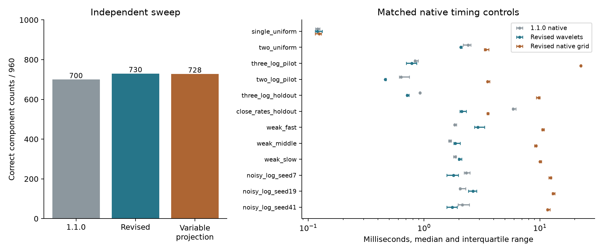

# LaplaceX 1.2.0: component detection

Measured on 21 October 2026 using the numerical algorithms released in 1.2.0.
Baseline core: commit `3708dd2` (version 1.1.0).
Numerical source SHA-256: `d0fe70e42153f16871b67cddcff1046985868bb81896a6a0fe636af0c180a70e`.

## Count recovery and parameter accuracy

| Dataset | Method | Correct count | Count + accuracy | Fit exceptions |
|---|---|---:|---:|---:|
| Exposed development | 1.1.0 wavelets | 708/960 | 573/960 | 0 |
| Exposed development | 1.2.0 wavelets | 738/960 | 613/960 | 0 |
| Exposed development | Variable projection + BIC | 737/960 | 613/960 | 0 |
| Independent seed | 1.1.0 wavelets | 700/960 | 562/960 | 0 |
| Independent seed | 1.2.0 wavelets | 730/960 | 596/960 | 0 |
| Independent seed | 1.2.0 native rate grid | 730/960 | 596/960 | 0 |
| Independent seed | 1.2.0 public default | 730/960 | 596/960 | 0 |
| Independent seed | Variable projection + BIC | 728/960 | 596/960 | 0 |
| Original mixtures | 1.1.0 wavelets | 480/480 | 475/480 | 0 |
| Original mixtures | 1.2.0 wavelets | 480/480 | 475/480 | 0 |
| Original mixtures | 1.2.0 native rate grid | 480/480 | 475/480 | 0 |
| Original mixtures | 1.2.0 public default | 480/480 | 475/480 | 0 |

The development sweep reuses seed 2026102101; its before/baseline measurements
come from the unchanged original research records. It is not independent evidence.
The independent sweep uses seed **2026102217**, fixed before its outcomes,
and reruns every comparator on exactly the same observations: two components,
amplitudes 1 and 0.5, rate ratios 1.1–10, Gaussian standard deviations
0.0001–0.05, uniform/geometric sampling, 600 observations, 20 realizations per cell.
All 960 outputs are retained. A rejected first candidate and its partly examined
seed-2026102207 observations were treated as development, never as final validation.

A noisy joint success requires the true count, maximum rate error ≤10%, and
clean-signal RMSE ≤noise standard deviation. Clean cases require the true count,
maximum rate error ≤1e-5, and normalized maximum reconstruction error ≤1e-8.
The native wavelet routes disable the Python rate-grid retry; public default
results are reported separately. The original 480-mixture variable-projection
count result remains 479/480 in the frozen research report; it was not rerun here.

### Count recovery does not guarantee accurate rates

| Independent sweep, correct-count fits only | Rate error, 95th percentile | Worst rate error |
|---|---:|---:|
| 1.1.0 wavelets | 33.70% | 977.83% |
| 1.2.0 wavelets | 41.11% | 977.83% |
| Variable projection + BIC | 40.50% | 977.83% |

Paired independent count outcomes: revised-only successes 2, variable-projection-only successes 0.
Paired joint outcomes: revised-only successes 0, variable-projection-only successes 0.
These are descriptive results on fixed synthetic conditions, not proof of
statistically significant or general accuracy superiority. Close noisy modes
can remain unidentifiable even when a two-mode fit is selected.

## Speed with accuracy checked on every timed fit

Nine shuffled round-robin repetitions after one warmup per method and case;
one BLAS thread. Times below are medians in milliseconds. The native routes
share the wrapper and compiler; the revised wavelet/grid routes also share
the projected optimizer, admissibility retry, and model-selection rules.
Variable projection uses the original SciPy/Python implementation with two
deterministic starts per count, K=1–5 and BIC. Its comparison includes language
and implementation costs. Validation-run elapsed times are not speed evidence.

| Case | 1.1.0 native | Revised wavelets | Revised grid | Variable projection | Grid / revised | Varpro / revised |
|---|---:|---:|---:|---:|---:|---:|
| single_uniform | 0.120 | 0.120 | 0.124 | 7.466 | 1.04× | 62.32× |
| two_uniform | 2.397 | 2.072 | 3.398 | 15.618 | 1.64× | 7.54× |
| three_log_pilot | 0.836 | 0.782 | 22.626 | 117.095 | 28.93× | 149.74× |
| two_log_pilot | 0.634 | 0.462 | 3.540 | 17.724 | 7.67× | 38.40× |
| three_log_holdout | 0.921 | 0.717 | 9.798 | 51.123 | 13.66× | 71.29× |
| close_rates_holdout | 5.888 | 2.113 | 3.559 | 19.632 | 1.68× | 9.29× |
| weak_fast | 1.836 | 2.921 | 10.593 | 49.020 | 3.63× | 16.78× |
| weak_middle | 1.671 | 1.865 | 9.276 | 32.045 | 4.97× | 17.19× |
| weak_slow | 1.859 | 2.017 | 10.049 | 56.571 | 4.98× | 28.04× |
| noisy_log_seed7 | 2.312 | 1.800 | 12.411 | 201.623 | 6.90× | 112.01× |
| noisy_log_seed19 | 2.054 | 2.638 | 13.011 | 133.942 | 4.93× | 50.77× |
| noisy_log_seed41 | 2.138 | 1.753 | 11.667 | 458.973 | 6.66× | 261.90× |

Every one of the nine fits per fixture and method passed the count and accuracy
targets. The public Python default is also timed and retained in the raw file.
The exact single-exponential shortcut is shared by both native routes; its
speed is not evidence for a wavelet advantage. The remaining native grid ratios
are the cleaner evidence for proposal-search savings.

Per-case changes relative to 1.1.0 include slowdowns: weak_fast (1.59× the old time), weak_middle (1.12× the old time), weak_slow (1.09× the old time), noisy_log_seed19 (1.28× the old time).
On these twelve fixtures the revised wavelets remain faster than both comparators,
but do not preserve latency on every existing workload.

### Balanced timing on the independent sweep

Take repeat 0 from every grid/ratio/noise cell, fixed before timing: 48 cases.
Use three shuffled rounds after warmup and retain wrong counts and all errors.
This is a subset of the accuracy sweep, not another independent accuracy sample.
The totals below sum the per-case median elapsed times; they are not a single
wall-clock run. No case was selected for passing or for being fast.

| Method | Sum of case medians, ms | Median case, ms | Correct counts | Count + accuracy |
|---|---:|---:|---:|---:|
| 1.1.0 wavelets | 779.66 | 8.394 | 36/48 | 30/48 |
| 1.2.0 wavelets | 745.30 | 4.817 | 37/48 | 31/48 |
| 1.2.0 native rate grid | 339.08 | 5.621 | 37/48 | 31/48 |
| Variable projection + BIC | 16938.66 | 313.990 | 37/48 | 31/48 |

The revised wavelet route uses **22.73× less cumulative time** than the Python variable-projection baseline.
However, the matched native grid uses **2.20× less cumulative time than wavelets** on this harder subset.
The revised wavelet route is slower than 1.1.0 in 16/48 cells.
The results support retaining a speed advantage over this Python comparator,
not a universal wavelet-search speed advantage. Matching native-grid detection
accuracy does not imply beating its runtime. All raw timed outputs are retained.

Hardware: Intel Core i7-7700HQ, Windows, Balanced power plan; clock frequency was
not fixed. See the original hardware record and raw metadata for Python, NumPy,
SciPy, compiler command, source hashes, and the installed extension checksum.

## Changes and checks

- Fit linear amplitudes by scaled, reorthogonalized QR at every nonlinear rate
  step. The projected rate Jacobian includes the residual-dependent correction;
  normal equations are not formed.
- Search both sides of an unresolved one-mode fit even when residual wavelet
  ridges fall below the noise threshold. Screen cheaply, then retain the existing
  full-data BIC/AICc decision.
- Cap screening variance by both measured noise and fitted residual variance.
  An incomplete model must not hide a weak signed component by calling model
  mismatch noise.
- Retry the original joint optimizer only for projected results violating the
  existing amplitude/coalescence limits. No new component count is prescribed.

- 1.1.0 wavelets: signed mixtures 230/240 correct counts, 217/240 joint successes; noise/constant checks 78/80.
- 1.2.0 wavelets: signed mixtures 230/240 correct counts, 219/240 joint successes; noise/constant checks 78/80.

The signed supplement is development/regression coverage, not another untouched
validation claim. The two null/constant failures occur in both versions; this
revision does not eliminate all false modes. Native QR amplitudes were checked
against NumPy SVD least squares and projected Jacobians against central finite
differences, including close rates. **163 tests pass** against the rebuilt wheel.



## Reproduction and raw records

```powershell
python -m pip install numpy scipy matplotlib pybind11
# Windows build helper also requires: python -m pip install ziglang
# The frozen case generator imports the original research harness.
python benchmarks/research/build_native.py --compiler .venv/Lib/site-packages/ziglang/zig.exe
# On Linux/macOS use --compiler c++ instead.
python benchmarks/detection/build_native.py
# Install LaplaceX 1.2.0 before validating the public API.
python benchmarks/detection/develop.py
python benchmarks/detection/check_native.py
python benchmarks/detection/validate.py --section legacy
python benchmarks/detection/validate.py --section holdout
# Run timing separately, after validation and other CPU-intensive jobs finish.
python benchmarks/detection/time_controls.py
python benchmarks/detection/time_balanced.py
python benchmarks/detection/summarize.py
```

Protocols: [main](PROTOCOL.md), [signed/null checks](STRESS_PROTOCOL.md).
Supplemental [balanced timing protocol](TIMING_PROTOCOL.md) and [raw records](results/balanced_timing.json).
Raw data: [development](results/development.json),
[independent sweep](results/holdout.json), [legacy replay](results/legacy.json),
[timing](results/timing.json), [native/signed/null checks](results/checks.json).
Use a Git checkout containing commit 3708dd2 for the before control. Source
checksums refer to checkout bytes, whose line endings are specified in .gitattributes.
The original measurements used a pre-release build carrying the 1.1.0 label.
Frozen raw metadata retains that provenance. The numerical source checksum
matches release 1.2.0; only packaging/version metadata changed afterward.
